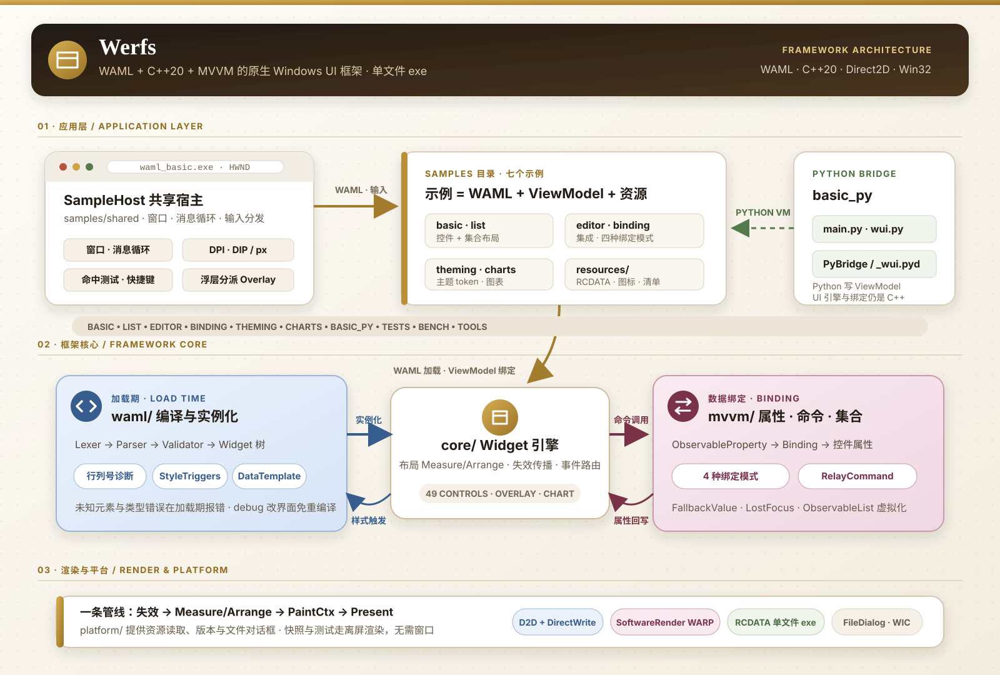

# Werfs

**WAML + C++20 + MVVM 的原生 Windows UI 框架与控件图库。**

用声明式的 WAML 描述界面，用 C++20 编写逻辑，用 MVVM 连接两者。所有渲染、布局、输入、焦点都由自研的 C++ 引擎完成 —— 没有 WebView、没有 .NET、没有 Qt、没有 JS 引擎。产物是单文件 exe。

> 版本 **0.13.4.0** · MIT · Windows 10/11 x64

---

## 这解决什么问题

Windows 上做原生界面，传统有两条路：Win32 裸写（繁琐、易错）或引入重型框架（依赖多、体积大）。Werfs 走第三条：**保留 Win32 的轻量，但用标记语言描述界面**。

```xml
<?waml version="0.1"?>
<Page Background="AppBackground">
  <StackPanel Orientation="Vertical" Spacing="12" Margin="24">
    <TextBlock Text="{Binding Title}" FontSize="28" FontWeight="SemiBold"/>
    <TextBox Text="{Binding Name, Mode=TwoWay}" PlaceholderText="Type a name"/>
    <CheckBox Content="Enabled" IsChecked="{Binding Enabled, Mode=TwoWay}"/>
    <Button Content="+" Command="{Binding IncrementCommand}"/>
    <TextBlock Text="{Binding Count, StringFormat='Count: {0}'}"/>
  </StackPanel>
</Page>
```

改界面不必重编译（debug 模式下），改逻辑只碰 ViewModel。

---

## 架构



应用层（`SampleHost` + 示例 + Python 桥）→ 框架核心（`waml` / `core` / `mvvm`）→ 渲染与平台（Direct2D / 软件光栅 / 资源 / 文件对话框）。WAML 在加载期编译成 Widget 树，绑定在运行时连接 ViewModel 与控件属性，渲染后端可替换为离屏光栅。

---

## 特性

| 能力 | 说明 |
|---|---|
| **WAML 声明式界面** | 元素、属性、属性元素、文本内容、CDATA、实体、标记扩展 |
| **静态校验** | 未知元素/属性、类型转换失败、语法错误全部在**加载期**报错，带行列号与建议 |
| **四种绑定模式** | `OneTime` / `OneWay` / `TwoWay` / `OneWayToSource`，默认按目标属性决定；`FallbackValue`、`UpdateSourceTrigger=LostFocus` |
| **DataTemplate** | 列表项由 WAML 描述，按项实例化 |
| **列表虚拟化** | `ListBox` 给定有界高度时只保留视口内的行，滚动即建/毁；模型 1000 行也只持有十几个控件 |
| **树形列表** | `TreeView` + `TreeNode`：节点自己持有子项与 `IsExpanded`，控件只画展开的分支；点击箭头折叠，命令可展开全部 |
| **图表与降采样** | `Chart`/`ChartPlot` 三种图形（折线/柱状/面积）+ 坐标轴与 nice 刻度；四种降采样模式；`ChartStream` 环形缓冲支持实时流，100 万点降到每像素一点，实测 **5.4 ms vs 37.2 ms** |
| **自绘引擎** | Direct2D + DirectWrite，无窗口也能离屏渲染（WARP + WIC） |
| **高 DPI** | DIP 布局 + 像素输入，已验证 200% 缩放 |
| **主题** | Light/Dark 双主题，12 个语义 token；`HostOptions::themeProperty` 让页面用一个 bool 实时切换 |
| **应用外壳** | 菜单栏（二级 + 三级子菜单，编辑器可从 View ▸ Text &amp; font size ▸ Content font size 调标签内容字号）· 工具栏（窄窗自动溢出）· 多标签（切换/关闭/新建/脏标记）· 模态确认对话框 |
| **文件对话框** | 打开 / 另存为 / 选文件夹，`IFileDialogService` 可注入假实现供无窗口测试 |
| **快捷键** | `Ctrl+N` `Ctrl+O` `Ctrl+S` `Ctrl+W`；菜单上显示的提示与真正生效的按键是同一个字符串 |
| **动画 / 等待指示** | `VisualState` 隐式过渡（颜色/数值/Thickness）；`LoadingSpinner` 四种主流等待动画（Windows 式转圈、四竖条长短变换、五球越顶回队首、经典三点弹跳）；通用渲染属性 `Opacity` / `ScaleX` / `ScaleY` / `Rotation` / `TranslateX` / `TranslateY`，变换只作用于绘制、不触发重排，相位由宿主注入、快照可冻结 |
| **单文件分发** | 图标、清单、版本信息、WAML 全部打包进 exe |

### 内置控件

按类别分组（下表为主要控件；完整清单见「控件覆盖范围」）：

| 类别 | 控件 |
|---|---|
| 布局 | `Grid`（行列 + 跨行跨列）· `StackPanel` · `WrapPanel` · `VariableSizedWrapGrid` · `Canvas` · `Viewbox` · `Expander` · `Border` · `Page` · `ScrollViewer` |
| 文本 | `TextBlock`（`TextWrapping="Wrap"`）· `TextBox`（多行折行、填满列宽） |
| 输入 | `Button` · `CheckBox` · `RatingControl`（星级评分） · `BreadcrumbBar`（可点击路径） |
| 状态 | `ProgressBar` · `ProgressRing` · `LoadingSpinner`（四种等待动画） |
| 集合 | `ListBox` + `DataTemplate` · `TreeView`（层级/展开/选中） · `TabView`（切换/关闭/新建） |
| 外壳 | `MenuBar` · `MenuBarItem` · `MenuFlyout` · `MenuFlyoutItem` · `MenuFlyoutSubItem` · `MenuFlyoutSeparator` · `CommandBar` · `AppBarButton` · `AppBarSeparator` · `AppBarToggleButton` · `ContentDialog` |

面板放置属性写在**子元素**上（本框架无附加属性语法）：

```xml
<Grid ColumnDefinitions="36,1*,auto" ColumnSpacing="12">
  <TextBlock Grid.Column="0" Text="1." />
  <TextBlock Grid.Column="1" Text="Item" />
  <TextBlock Grid.Column="2" Text="layout" />
</Grid>
```

`ColumnDefinitions` 支持 `Auto` / `1*` / `80`，大小写不敏感；`Canvas.Left`/`Top` 做绝对定位；`VariableSizedWrapGrid.ColumnSpan`/`RowSpan` 做混合尺寸贴片。

---

## 构建

需要 **PowerShell 5.1+** 和 **Visual Studio 2022**（含 C++ 工作负载）。脚本会自动定位 VS（优先 `vswhere`，回退到常规安装路径），无需手动打开 Developer PowerShell。

```powershell
pwsh -File build.ps1              # 优化构建，WAML 打包进 exe（默认 release）
pwsh -File build.ps1 debug        # 调试构建，WAML 运行时读磁盘文件
pwsh -File build.ps1 all          # 构建全部目标
pwsh -File build.ps1 tests        # 只构建测试
pwsh -File build.ps1 all -Clean   # 清空输出目录后重建
```

### 目标（Target）

| 目标 | 产物 | 说明 |
|---|---|---|
| *（无参数）* | 全部示例 | **默认**：等价于 `samples` |
| `samples` | `waml_basic.exe` `waml_list.exe` `waml_binding.exe` `waml_theming.exe` `waml_usercontrol.exe` `waml_editor.exe` `waml_charts.exe` `waml_animation.exe` | 构建所有示例（release） |
| `basic` | `waml_basic.exe` | 只构基础控件示例 |
| `list` | `waml_list.exe` | 只构集合与布局示例 |
| `binding` | `waml_binding.exe` | 只构绑定模式示例（四种模式对照） |
| `theming` | `waml_theming.exe` | 只构主题示例（token + 实时 Light/Dark） |
| `usercontrol` | `waml_usercontrol.exe` | 只构组件作用域示例（一份模板、三份数据源） |
| `charts` | `waml_charts.exe` | 只构图表示例（百万点实时流 + 50 柱/50 线 + K 线时间范围 + 视口暂停） |
| `animation` | `waml_animation.exe` | 只构动效示例（四种等待动画 + 阻尼移动/渐隐渐显/缩放 + 注入式帧时钟） |
| `editor` | `waml_editor.exe` | 只构编辑器示例（菜单/工具栏/多标签/文件对话框） |
| `basic_py` | `_wui.pyd` `waml_basic_py.exe` | Python 驱动 MVVM 示例（经 CMake 构建，详见下文） |
| `all` | 全部 | 示例 + 全部工具与测试 |
| `debug` | 各示例 | 符号 + WAML 读磁盘，改界面免重编 |
| `tests` | `waml_tests.exe` | 266 个用例 |
| `bench` | `waml_bench.exe` | 性能基线 |
| `snapshot` | `waml_snapshot.exe` | D2D 渲染 + 确定性校验 |
| `interact` | `waml_interact.exe` | 无窗口输入驱动 |
| `probe` | `waml_probe.exe` | 资源门禁，**构建后自动运行** |
| `probedbg` | 同上 | 调试构建的门禁 |
| `res` | `.res` | 只编译资源 |
| `icon` | `app.ico` | 重新生成图标 |
| `dpishot` | `waml_dpishot.exe` | DPI 截图工具 |

### 输出目录

产物默认在 `build\<config>\`。要输出到别处：

```powershell
pwsh -File build.ps1 all -OutDir D:\dist
```

也可以用环境变量（兼容旧用法，`-OutDir` 优先）：

```powershell
$env:WUI_OUT = 'D:\dist'
pwsh -File build.ps1 all
```

> **为什么建议输出到工程外**：由自动化/沙箱会话创建的可执行文件可能带上一条未解析 SID 的权限项（`S-1-4-*`），会让 SmartScreen 每次启动都弹「Windows 已保护你的电脑」，即使二进制完全正常、且与手动构建的逐字节相同。诊断：`icacls 目标.exe | findstr /i "S-1-4"`。

### 版本号

单一来源，CI 可用同名环境变量覆盖：

当前默认版本为 `0.13.4.0`。CI 可用同名环境变量覆盖任意字段：

```powershell
$env:WUI_VERSION_PATCH = '3'
pwsh -File build.ps1 all
```

也可直接改 `samples/basic/resources/BasicResource.h` 等各示例资源头中的默认值。

### 为什么是 PowerShell 直接驱动编译器

脚本直接调用 `cl.exe` / `link.exe` / `rc.exe`，不经过 CMake —— CMake 与 Ninja 都通过管道捕获子进程 stdout 来解析诊断，在受限环境下该管道无法创建，导致 configure **挂起而非报错**。直接调用工具链让子进程继承 stdio，受限与完全权限下都能工作。

从 cmd 迁到 PowerShell 还顺带消除了两个曾耗费大量排查时间的缺陷：

- `%~dp0` 末尾的反斜杠让 `/I"%~dp0"` 吞掉下一个参数，报 `D8003: missing source filename`；
- `/Fo"dir\"` 同样让尾部反斜杠转义引号，`.obj` 落到当前目录而非目标目录。

现在参数以数组传递，不再经过任何命令行解析。

CMake 仍然可用（`CMakeLists.txt` 已同步），适合常规开发机；本仓库以 `build.ps1` 为主路径。

### Python 驱动的示例：`basic_py`

ViewModel 用 Python 写，WAML 与渲染引擎仍是 C++。原生扩展 `_wui.pyd` 把 Python 对象的属性注册成 `IPropertySource`、把方法注册成 `ICommand`；exe 只是嵌入式 CPython 启动器。**不携带 Python 运行时**：两个产物都链接 `python3.lib`（稳定 ABI 导入库），运行时从系统安装的 CPython 加载 `python3.dll`，要求机器上装有 Python 3.8+（开发头文件/导入库）。

两种运行方式共用同一份 `main.py`、`wui.py`、`BasicPy.waml` 和 `_wui.pyd`：

```powershell
pwsh -File build.ps1 basic_py                  # 或直接用 CMake：cmake --build <build> --config Release --target waml_basic_py

cd samples\basic_py
python main.py                                  # 系统 Python 直接跑
python main.py --selftest                       # 无窗口自检（结果写入 selftest.log）

cd ..\..\build\basic_py
.\waml_basic_py.exe                             # GUI 启动器，同样跑 main.py
.\waml_basic_py.exe --selftest                  # Python 错误写入 python_error.log
```

Python 侧约定（见 `samples/basic_py/wui.py`）：

- ViewModel 继承 `wui.ObservableObject`，在 `_wui_props` 里声明属性类型：`text` / `int` / `float` / `bool` / `command`；
- 属性赋值经 `__setattr__` → native `_notify` → binding，OneWay 标签会跟随；
- View 的写入（TextBox / CheckBox / Slider）回写 Python 属性后调用 `on_changed(name, value)`，派生文本留在 ViewModel 里；
- callable 属性映射为按钮的 `Command`，可选 `fn.can_execute()` 决定 `CanExecute()`。

`msvcrt`/`pybind11` 均未使用：桥接只依赖 CPython 稳定 ABI（`Py_LIMITED_API=0x03080000`），因此一个 `_wui.pyd` 可被任意 3.8+ 的 CPython 加载。该示例不进入 `$SampleRegistry`——它产出的不是带 `wWinMain`/RCDATA 的普通 C++ sample。

---

## 目录结构

框架与示例是两棵独立的树：**框架不认识任何具体示例**，示例单向依赖框架。

```text
framework/src/
    core/       Widget 树、布局、失效传播、控件、值类型、主题、浮层（Overlay）
    mvvm/       ObservableProperty / ObservableList / RelayCommand / Binding
    waml/       Lexer、Parser、Validator、诊断、实例化
    platform/   Resources（资源/版本/路径）、FileDialog（打开/保存/选文件夹）
    render/     SoftwareRender（测试用）、D2DRender（真实后端）

samples/                ← 示例，单向依赖框架
    shared/                共享宿主：窗口、D2D、DPI、输入分发、浮层分派
    basic/                 **已实现** 基础控件：TextBlock/Button/TextBox/CheckBox/Border
    list/                  **已实现** 集合与布局：ListBox + Grid/WrapPanel/Canvas/VariableSizedWrapGrid/Viewbox/Expander/TabView
    editor/                **已实现** 集成：菜单 + 工具栏 + 多标签 + 未保存提示 + 文件对话框
    binding/               **已实现** 四种绑定模式对照（含 FallbackValue / LostFocus）
    theming/               **已实现** Light/Dark 实时切换与 token 面板
    usercontrol/           **已实现** 父子组件、三层独立数据源（页面 → 卡片 → 徽章）
    animation/             **已实现** 四种等待动画 + 阻尼移动 / 渐隐渐显 / 缩放三种组件变换
    basic_py/              **已实现** Python ViewModel 驱动 UI（main.py / wui.py / native 桥接 / exe 启动器）

tests/   bench/   tools/     ← 框架级工具，不依赖示例
```

关键约束：`framework/` 里**没有**任何示例的 `.waml`、ViewModel 或 `IDR_WAML_*`。资源 id 属于示例，定义在 `samples/basic/resources/BasicResource.h`；框架只提供「按类型名 + id 读取 RCDATA」的通用接口。

新增示例：复制 `samples/basic/` 改名、改 `Resource.h` 里的 id、在 `build.ps1` 的 `$SampleRegistry` 加一行即可，框架侧零改动。

> 各示例的资源头文件名必须唯一（`BasicResource.h`、`ListResource.h`…）。两个示例都用 `Resource.h` 时，工具同时引入两者会撞名，先命中的那个会静默胜出——这正是 `IDR_WAML_BASIC 未声明` 的由来。

### 示例路线

示例不是一堆 demo，而是一条由简到繁的学习路径，同时是框架能力的验收矩阵：

| 顺序 | 示例 | 内容 | 状态 |
|---|---|---|---|
| 1 | `basic` | **基础控件**：TextBlock / Button / TextBox / CheckBox / Border，单一数据源 | **已实现** |
| 2 | `list` | **集合 + 布局**：ListBox/DataTemplate、Grid、WrapPanel、VariableSizedWrapGrid、Canvas、Viewbox、Expander、TabView | **已实现** |
| 3 | `editor` | **集成**：菜单栏 + 工具栏 + 多标签 + 未保存提示 + 文件对话框 | **已实现** |
| 4 | `binding` | **绑定对照**：四种模式并排、StringFormat、FallbackValue、LostFocus | **已实现** |
| 5 | `theming` | **主题**：12 个 token 面板、Light/Dark 实时切换、字面量对照 | **已实现** |
| 6 | `usercontrol` | **父子组件 + 三层独立数据源**：页面 → 每行卡片 → 卡片内徽章 | **已实现** |
| 7 | `animation` | **四种主流等待动画**：Windows 式转圈 / 四竖条 / 五球越顶回队首 / 三点弹跳，共用一个注入式相位 | **已实现** |
| 8 | `basic_py` | **Python 驱动 MVVM**：ViewModel 用 Python 写，C++ 只做 UI 引擎 | **已实现**（经 CMake 构建） |
| 9 | `charts` | **成本**：百万点实时流、四种降采样、实测帧率 | **已实现** |

九个示例分工明确：`basic` 是**入门页**（五个控件、一个数据源，看完就会写第一段 WAML），`list` 是**布局验收现场**（六个面板装进一个真实页面，也因此暴露了 `auto` 列宽、跨行重叠、文字换行三个缺陷），`editor` 是**集成点**（把文件对话框、菜单、工具栏、标签页、模态确认串成一个能真用的窗口），`binding` 是**行为对照**（同一个属性四种绑法并排，差异肉眼可见），`theming` 是**颜色分层**（token 跟主题走、字面量不动），`usercontrol` 是**数据源分层**（一份模板三份数据，卡片内嵌的徽章读卡片而不是页面），`animation` 是**时间边界**（一个注入的 `dt` 同时驱动四种等待动画和三种组件属性变换，暂停即冻结、快照仍确定性），`charts` 是**成本**（同一份百万点数据，开与不关降采样的帧时间当场量给你看），`basic_py` 是**语言边界**（ViewModel 用 Python 写，UI 引擎与绑定仍是 C++）。

> `files` 示例**已并入 `editor`**：它原本的四个区块（打开 / 另存为 / 选文件夹 / 读取预览）里，前三个和第四个都是编辑器的正常功能；单独做一个示例只会变成「按钮 → 弹框 → 显示路径」的纯演示，没有真实用途来暴露接线错误。

所有示例共用 `samples/shared/SampleHost`（Win32 窗口 + D2D + DPI + 输入分发 + 浮层分派），示例本身只提供 WAML、ViewModel 和标题。加一个新示例 = 新建目录 + 三件套 + 在 `build.ps1` 的注册表加一行。详细规划见 `CODE_PLAN.md` §10a。

### 控件覆盖范围

对齐 WinUI-Gallery 的完整清单是 **90 个待实现控件**（已剔除 15 个概念页与 14 个需要 OS 集成的条目）。本项目**不追求一次做完**，按使用频率分三档：

| 档位 | 数量 | 内容 | 何时做 |
|---|---|---|---|
| **P0 必做** | 23（**✅ 全部完成**） | ✅ `Grid` `Canvas` `WrapPanel` `VariableSizedWrapGrid` `Viewbox` `Expander` `RelativePanel` `ToggleButton` `RepeatButton` `HyperlinkButton` `RadioButton` `Slider` `ToggleSwitch` `PasswordBox` `NumberBox` `ProgressBar` `ProgressRing` `InfoBar` `InfoBadge` `Image` `PersonPicture` `Line` `Shape` | 已完成 |
| **已提前完成** | 12 | `TabView`（原 P2）· `MenuBar` `MenuBarItem` `MenuFlyout` `MenuFlyoutItem` `MenuFlyoutSubItem` `MenuFlyoutSeparator` `CommandBar` `AppBarButton` `AppBarSeparator` `ContentDialog`（原 P1，浮层完成后一并落地）· 以及 `OverlayLayer` 这个非控件能力 | 已实现 |
| P1 常用增强 | 16（**14 已完成**） | ✅ `ComboBox` `Flyout` `ToolTip` `Popup` `ContentDialog` `AutoSuggestBox` `MenuFlyout` `CommandBar` `AppBarButton` `AppBarToggleButton` `AppBarSeparator` `MenuBar` `BreadcrumbBar` `RatingControl` ／ 待做 `TeachingTip` `SplitView` | 进行中 |
| P2 长尾 | 51 | 虚拟化集合、日期时间、动画过渡、导航容器、媒体等 | 按需，不承诺 |

目前 **55 个控件可用**（原有 9 个 + 6 个布局面板 + 10 个外壳控件 + P0 补齐的 17 个 + P1 弹出的 8 个 + 图表 `Chart`/`ChartPlot` + `LoadingSpinner` + `AppBarToggleButton`/`BreadcrumbBar`/`RatingControl`）。框架改造已全部完成：`Grid` 行列布局、`VariableSizedWrapGrid` 跨行列换行、`TextBlock`/`TextBox` 文字换行、**浮层子系统**（`OverlayLayer`，同时解锁菜单、工具栏溢出与模态）、**单选模型**、**快捷键路由**、**`RelativePanel` 附加属性与按名查兄弟**、**`Image` 的 WIC 解码（可注入）**、**`PaintCtx` 画线/椭圆/位图**、**`RadioButton` 组作用域**、**`HorizontalAlignment`/`VerticalAlignment`**、**`FontFamily` 等宽字体**、**承载任意控件子树的 `Flyout` 浮层**、**`VisualState` 与动画过渡**、**`Popup` 原语与 `AutoSuggestBox`**、**`LoadingSpinner` 的四种等待动画**、**`Expander.IsExpanded` 可绑定**、**`AppBarToggleButton`/`BreadcrumbBar`/`RatingControl`**。

---

## 工具

| 目标 | 用途 |
|---|---|
| `waml_basic.exe` / `waml_list.exe` / `waml_binding.exe` / `waml_theming.exe` / `waml_usercontrol.exe` / `waml_editor.exe` / `waml_charts.exe` / `waml_animation.exe` | 真实 Win32 窗口 |
| `<sample>.exe --selftest` | 无窗口自检，写 `selftest.log`，退出码表示结果 |
| `waml_tests.exe` | 266 个单元/集成用例 |
| `waml_interact.exe <页面.waml>` | 无窗口驱动真实输入（点击、键盘、菜单、对话框）；按文件名分派到对应页面的检查 |
| `waml_snapshot.exe` | D2D 渲染 + 确定性校验（两次渲染 SHA 必须相同） |
| `waml_probe.exe` | 资源与交付模式门禁（缺失资源、陈旧 `.res`、权限标记） |
| `waml_bench.exe` | 性能基线 |

所有工具遵循同一个交付开关：**debug 读 `samples/*/*.waml`，release 读 exe 内嵌资源**；显式传路径时以路径为准。

### 编辑器示例怎么玩

`waml_editor.exe` 是唯一「像真实程序」的示例，可以直接上手：

| 操作 | 会发生什么 |
|---|---|
| 点标签 | 切换文档，编辑区换成那篇文本 |
| 点标签上的 `×` | 干净文档**直接关**；改过的文档弹「保存 / 不保存 / 取消」 |
| 在提示里选「取消」 | **标签还在，内容一字未丢** |
| 点 `+` 或 File ▸ New | 新建 `<Untitled N>` 并立刻激活 |
| 在编辑区打字 | 标签出现 `•`（脏标记），状态栏变 `modified`；删掉那个字又变回 `saved` |
| File ▸ Open | 弹真实文件对话框，选中的文本文件成为新标签 |
| File ▸ Save as | 弹真实保存对话框，写入磁盘并把当前内容设为「干净基准」 |
| 缩窄窗口 | 工具栏尾部按钮收进 `⋯`，点 `⋯` 展开成菜单 |
| View ▸ Text &amp; font size ▸ Content font size ▸ 12/14/16/18 pt | 三级菜单：只改**标签内容**字号，标签与工具栏不变 |
| `Ctrl+N/O/S/W` | 新建 / 打开 / 保存 / 关闭当前标签 |

菜单里的 **Save 在没有文档时是灰的** —— 打开 File 菜单按下「无文档」状态看一眼，就能确认菜单项启用状态是**打开菜单时**读的，不是加载界面时写死的。

`View ▸ Text &amp; font size ▸ Content font size` 是三级菜单：菜单层保存一条「打开到第几层、每层停在哪一行」的路径，因此每一层都有相同的悬停高亮、箭头与点击处理；`Esc` 每次只退回一层。字号只绑在编辑区那个 `TextBox` 的 `FontSize` 上，调用 `SetFontSize` 的四条命令与菜单行一一对应。

### 写法示例：菜单 / 工具栏 / 模态

```xml
<Page Background="AppBackground">
  <MenuBar Height="34" Background="CardBackground">
    <MenuBarItem Title="File">
      <MenuFlyout>
        <MenuFlyoutItem Text="New"  Hint="Ctrl+N" Command="{Binding NewCommand}"/>
        <MenuFlyoutSeparator/>
        <!-- 启用状态在打开菜单时按 CanExecute 求值，无文档即为灰 -->
        <MenuFlyoutItem Text="Save" Hint="Ctrl+S" Command="{Binding SaveCommand}"/>
        <MenuFlyoutSubItem Text="Close">
          <MenuFlyout>
            <MenuFlyoutItem Text="Close tab" Command="{Binding CloseTabCommand}"/>
            <MenuFlyoutItem Text="Reopen last closed" Command="{Binding ReopenCommand}"/>
          </MenuFlyout>
        </MenuFlyoutSubItem>
      </MenuFlyout>
    </MenuBarItem>
    <MenuBarItem Title="View">
      <MenuFlyout>
        <MenuFlyoutSubItem Text="Text &amp; font size">
          <MenuFlyout>
            <MenuFlyoutSubItem Text="{Binding FontSizeLabel}">
              <MenuFlyout>
                <MenuFlyoutItem Text="16 pt" Command="{Binding Font16Command}"/>
              </MenuFlyout>
            </MenuFlyoutSubItem>
          </MenuFlyout>
        </MenuFlyoutSubItem>
      </MenuFlyout>
    </MenuBarItem>
    </MenuBar>

    <CommandBar Height="44">

    <AppBarButton Icon="✚" Label="New"  Command="{Binding NewCommand}"/>
    <AppBarButton Icon="▼" Label="Save" Command="{Binding SaveCommand}"/>
  </CommandBar>

  <TabView ItemsSource="{Binding Documents}"
           SelectedIndex="{Binding ActiveIndex, Mode=TwoWay}"
           CloseRequested="{Binding CloseRequested, Mode=TwoWay}"
           AddCommand="{Binding NewCommand}"/>

  <!-- 声明一次，按需显示：确实不进布局流，是挂在根节点上的浮层 -->
  <ContentDialog Title="{Binding PromptTitle}" Message="{Binding PromptMessage}"
                 IsOpen="{Binding PromptOpen, Mode=TwoWay}"
                 Result="{Binding PromptResult, Mode=TwoWay}"
                 PrimaryButtonText="Save" SecondaryButtonText="Don't save"
                 CloseButtonText="Cancel"/>
</Page>
```

三条约束值得记住：

- **`CloseRequested` 必须是 `TwoWay`**。`OneWay` 绑定会忽略目标侧写入，控件发布的关闭请求会凭空消失（`CODE_PLAN.md` §7.16）。
- **浮层不进布局**。`MenuBar`/`CommandBar` 占位，但它们弹出的菜单、工具栏的 `⋯`、`ContentDialog` 都画在根节点上，所以放在 `ScrollViewer` 里也不会被裁掉。
- **对话框的 `Enter` 落在主按钮、`Esc` 只落到「取消」**。丢弃数据的按钮永远不会成为默认按钮。
- **子菜单可以任意深**。`MenuFlyoutSubItem` 里再放 `MenuFlyoutSubItem` 就是三级；它们仍属于同一个浮层，`Esc` 逐层关闭，不是再开一个 overlay。

### 写法示例：样式 / 资源 / 触发器

```xml
<Page Background="AppBackground">
  <!-- 具名字面量：一次声明，任意字面量位置可用 -->
  <ResourceDictionary>
    <Color x:Key="Brand">#0A84FF</Color>
    <Number x:Key="CardRadius">6</Number>
    <Thickness x:Key="CardPad">16,12,16,12</Thickness>
  </ResourceDictionary>

  <!-- 具名样式：可 BasedOn 继承 -->
  <Style x:Key="Card" TargetType="Border">
    <Setter Property="Background" Value="CardBackground"/>
    <Setter Property="CornerRadius" Value="{StaticResource CardRadius}"/>
    <Setter Property="Padding" Value="{StaticResource CardPad}"/>
  </Style>

  <Style x:Key="HighlightCard" TargetType="Border" BasedOn="{StaticResource Card}">
    <Setter Property="Background" Value="{StaticResource Brand}"/>
  </Style>

  <!-- 触发器：条件成立时追加设置，不成立时自动恢复 -->
  <Style x:Key="TintedBox" TargetType="CheckBox">
    <Setter Property="Background" Value="CardBackground"/>
    <Trigger Property="IsChecked" Value="True">
      <Setter Property="Background" Value="ControlFill"/>
    </Trigger>
  </Style>

  <Border Style="{StaticResource Card}" BorderThickness="0,1,0,0"/>  <!-- 本地覆盖样式 -->
  <CheckBox Content="highlight me" Style="{StaticResource TintedBox}"/>
</Page>
```

四条约束值得记住：

- **优先级是「本地 > 样式 > 默认」**，触发器也属于样式，所以内联属性永远赢。写 `FontSize="11"` 的元素不会被它的样式或触发器改掉字号。
- **样式在加载期解析**。`Setter` 写了类型上不存在的属性、`BasedOn` 拼错、`Style` 引用不存在的 key，都是**带行号的加载错误**，不会在运行时静默无效。
- **样式必须在同一个文件里声明**，但可以写在任何位置（写在页面末尾引用在前面也合法）。
- **触发器会恢复**。它记录激活前的值，条件不再成立时写回；同时监视的属性被重置后，元素回到样式原本的样子，而不是永久留着触发值。

---

## 诊断

所有错误在加载期给出，带行列号（列按 Unicode 码点计）：
```text
demo.waml(12,5): error WAML0102: 'wui/TextBlock' has no property 'Txt' (did you mean 'Text'?)
```

| 码段 | 含义 |
|---|---|
| WAML0001–0004 | 词法、标签结构、重复属性、属性格式 |
| WAML0101–0106 | 未知元素、未知属性、只读属性、值转换失败、内容模型、必需属性缺失 |
| WAML0201–0204 | 标记扩展语法、模式不兼容、绑定路径、重复名字 |
| WAML0301 | DataTemplate 根元素数量 |

运行期绑定失败通过 `SetBindingDiagnostics()` 注入的 sink 上报，并提供 `BindingErrorCount()` 计数 —— **不会静默失败**。

---

## 性能基线

实测于本机（MSVC `/O2`，预热后取 median）：

| 操作 | 实测 |
|---|---|
| 解析+校验 | 45–53 MB/s |
| 绑定更新（OneWay） | 89 ns |
| 双向回写 | 111 ns |
| 布局（100 项列表） | ~102 µs |
| 软件光栅 1280×800 一帧 | 0.41 ms |

### 列表虚拟化

`ListBox` 拿到**有界高度**时（自己写了 `Height=`，或父面板给的高度有限），它会变成一个**视口**：只保留视口内的行（外加一行 overscan），滚出去的行连同它的绑定一起释放。模型 1000 行，实际控件十几个。

| 场景 | 行为 |
|---|---|
| `Height="260" ItemHeight="26"` | 虚拟化：约 13 个行控件 |
| 放在 `ScrollViewer` 里（高度无界） | **不虚拟化**：全部行都实例化，由外层滚动器负责滚动 |

这条切换由**约束**决定，不由开关决定 —— 这也是既有页面一行都不用改的原因：所有示例的列表都在 `ScrollViewer` 里，行为与改动前完全一致。

四个属性让页面能**看到**窗口在动（都是控件写给 ViewModel 的，`Mode=TwoWay`）：`RealizedCount`、`IsVirtualized`、`FirstVisibleIndex`、`ScrollOffset`（这个也是输入，ViewModel 写它即可滚动），外加只读的 `ScrollMax`。`samples/list` 第 8 节就是把这几个值直接印在页面上。

两条契约值得记住：

- **行高固定**。窗口化要用「第 N 行在哪」做算术，不去测量它前面的每一行；行高可变的列表不能窗口化。
- **`ItemWidgetAt(i)` 返回空不等于项不存在**。它问的是「这一行现在实现了没有」；`ItemAt(i)` 才是模型。所以任何需要「所有行同时在场」的逻辑（例如逐行统计控件）都必须用非虚拟化路径。

### 图表与降采样

```xml
<!-- 一条百万点的实时曲线：给个高度就成图，坐标轴与刻度自己算 -->
<Chart Series="{Binding Stream}" Height="320" AutoFit="True" ShowFps="{Binding ShowFps}"
       Downsample="{Binding DownsampleMode}"/>
```

折线 / 柱状 / 面积共用同一套坐标变换：`Line`、`Bar`、`Area`；K 线用独立的 `CandleSeries`（开高低收不能塞进一个 `(x,y)` 点）。刻度只取 **1/2/5 × 10ⁿ**，因为网格标着 0、333.3、666.7 的图没人读得下去。

**实时流用环形缓冲，不是不断增长的数组**。`ChartStream` 容量固定，新样本挤掉最旧的，所以窗口的成本在一小时后和下一秒完全一样。x 值是**绝对样本序号**——样本 N 永远是值 N，于是窗口在信号上向左滑过，而不是每秒把所有点重新编号（那样看起来永远不动）。

**降采样是重点，参考库不做这件事**（它把每个点直接交给 WPF 的 `Polyline`）。四种模式：

| 模式 | 做法 | 代价 |
|---|---|---|
| `None` | 每个点都画 | 100 万点 = 每帧 100 万条线段 |
| `Uniform` | 每隔 k 个取一个 | 最便宜，但**会丢掉尖峰** |
| `MinMax` | 每桶取最小/最大 | 保留包络，尖峰丢不掉 |
| `LTTB` | 保留构成最大三角形的点 | 轮廓最接近原图（默认） |

100 万点实时窗口、700×300 软件光栅实测（数字由渲染路径本身产生）：

| 模式 | 帧时间 | 绘制点数 |
|---|---|---|
| `LTTB` | **5.44 ms** | 560 |
| `MinMax` | **5.36 ms** | 560 |
| `Uniform` | **5.60 ms** | 560 |
| `None` | **37.2 ms** | 1,000,000 |

`samples/charts` 现在是三张图：百万点实时流、**50 柱 + 50 点折线**（RGB 滑块调色、CheckBox 分别开关柱/线）、**K 线 + 下方时间范围滑块**（含近 7/30 天与全部预设）。`Chart.ViewportVisible` 由控件结合 `ScrollViewer` 几何发布回 ViewModel：视口外的图不画，实时流也停止推进，滚回来才恢复。

**三条契约**：

- **预算是像素，不是常数**。`MaxPoints=0` 表示「每水平像素一个点」，宽窗口不会比窄窗口画得更粗。
- **`Uniform` 会丢尖峰**。测试里明确断言了这一点（`uniform=10.0 minmax=40.0 lttb=40.0`），因为一个只会说「我们都支持」的图表库不会告诉你哪个模式在骗你。
- **帧率是量出来的，不是写死的**。`ShowFps` 在图表右上角画出实时帧率，取自**真实绘制间隔**的平滑值；没有帧就不画数字（`0 fps` 会被读成「图表卡死了」，而真相是「还没人驱动帧时钟」）。

---

本项目用 `build.ps1` 直接驱动 `cl.exe`/`link.exe`/`rc.exe`，而不是 CMake：CMake 与 Ninja 都通过管道捕获子进程 stdout 来解析诊断，在某些受限环境下该管道无法创建，导致 configure 挂起。这是**环境限制**，不是设计结论 —— 常规开发机请用 CMake（`CMakeLists.txt` 已保留并同步）。详见上文「为什么是 PowerShell 直接驱动编译器」。

版本号单一来源：`build.ps1` 的 `WUI_VERSION_*` → 各示例 `resources/*Resource.h` → `app.rc` → 写入 exe 的 `VERSIONINFO`。示例窗口标题只显示示例名称，不带版本号。

---

## 已知边界

- **无 `VisualState` / 主题资源字典**：有 `Style`/`Setter`/`Trigger`，但没有多状态切换（`Normal`/`PointerOver`/`Pressed` 一站式的状态机）与过渡动画。触发器可以模拟简单的两态，复杂状态建议等动画落地。
- **样式不能绑定**：`Setter` 只接受字面量（可引用资源）。样式在加载期解析成槽位值，「一个样式对所有使用者共享一份值」在这个前提下才有意义；需要按数据变化的外观用触发器或绑定到元素自身。
- **样式不能跨文件共享**：没有合并字典，`<Style>` 只在声明它的文档内可见。

### 写法示例：等宽字体与弹出层

```xml
<!-- 等宽字体：代码片段靠它对齐列 -->
<TextBlock Text="name  = &quot;WAML&quot; /  value = 42"
           FontFamily="Consolas" FontSize="13"/>

<!-- ComboBox：Items 用 ';' 分隔（逗号会撞上「Paris, France」这类真实数据） -->
<ComboBox Items="C++;C#;Rust;Python;Go"
          SelectedIndex="{Binding LanguageIndex, Mode=TwoWay}"/>

<!-- Flyout：弹层里放真实控件，不是一排菜单项 -->
<Flyout Content="Advanced...">
  <StackPanel Spacing="8">
    <ToggleSwitch Content="Wrap long lines" IsChecked="{Binding WrapLines, Mode=TwoWay}"/>
    <Button Content="Reset" Command="{Binding ResetCommand}"/>
  </StackPanel>
</Flyout>

<!-- ToolTip：悬停显示，点击穿透到下面的控件 -->
<ToolTip Text="这行提示只在悬停时出现。">
  <TextBlock Text="把鼠标放在这句话上。"/>
</ToolTip>
```

四条约束值得记住：

- **`FontFamily` 空字符串 = 系统默认**，所以既有页面一个字都不用改。等宽族名（Consolas、Cascadia、Courier…）在 headless 文本服务里用 0.6 em 而不是 0.55 em 的字宽，这样布局测试能分辨字体，不用 DWrite 也能验证。
- **`ComboBox` 的 `SelectedText` 是从 `SelectedIndex` 派生的**，绑哪个都行，两者不可能互相矛盾。方向键在**收起状态下**直接改选中项（Windows 惯例），不必先展开列表。
- **`Flyout` 的内容会离开控件树**，进入浮层。这不是实现细节走漏：留在树里的弹层会被父布局测量（收起时仍占位），也会被上层的 `ScrollViewer` 裁剪。
- **`ToolTip` 不是浮层**，而且 `HitTest` 恒返回空。它只负责给下面的控件贴标签，一旦拦截点击就会破坏它描述的那个控件。

### 写法示例：视觉状态与动画

```xml
<Style x:Key="Lively" TargetType="Button">
  <Setter Property="FontSize" Value="14"/>

  <!-- 悬停：150ms 内放大到 16 -->
  <VisualState Name="PointerOver" Transition="0.15">
    <Setter Property="FontSize" Value="16"/>
  </VisualState>

  <!-- 按下：80ms 内缩小到 13，比悬停更快，手感才“跟手” -->
  <VisualState Name="Pressed" Transition="0.08">
    <Setter Property="FontSize" Value="13"/>
  </VisualState>

  <!-- 禁用：不过渡，直接生效 -->
  <VisualState Name="Disabled" Transition="0">
    <Setter Property="FontSize" Value="12"/>
  </VisualState>
</Style>

<Button Content="Hover me" Style="{StaticResource Lively}"/>
```

五条约束值得记住：

- **状态由输入层选择，属性做不到**。这就是 `VisualState` 与 `Trigger` 的分工：触发器监听某个属性是否等于某个值（元素自己知道条件成立）；而“指针正按着”不是属性，没有任何绑定能观察到它，所以悬停/按下只能用 `VisualState`。
- **优先级是「本地 > 视觉状态 > 样式 > 默认」**。状态赢过样式，因为它是更具体、更晚的决定（“这个按钮、此时此刻”）；但它输给本地值，理由和触发器一样。
- **离开状态会恢复**。每个状态进入时记下被它改动的槽位的原值，离开时写回。所以 `Normal` 不必把其它状态的每个属性再声明一遍。
- **`Normal` 是隐式的**，永远存在，表示“没有任何状态修饰”。不声明它也行——这正是关键：如果把它当成“未知状态名”而忽略，上一个状态的值就会永久留在控件上。
- **动画时间是注入的**。`AnimationHost::AdvanceAll(dt)` 接收调用方给的秒数：宿主给真实流逝时间，测试给 `1/60` 并断言精确中间值。内部去读系统时钟会让每个动画测试天生不稳定。

### 写法示例：四种等待动画

```xml
<Grid ColumnDefinitions="1*,1*" RowDefinitions="Auto,Auto" ColumnSpacing="12" RowSpacing="12">
  <LoadingSpinner Grid.Row="0" Grid.Column="0" Kind="Ring"   Phase="{Binding Phase}" Size="72"/>
  <LoadingSpinner Grid.Row="0" Grid.Column="1" Kind="Bars"   Phase="{Binding Phase}" Size="72"/>
  <LoadingSpinner Grid.Row="1" Grid.Column="0" Kind="Dots"   Phase="{Binding Phase}" Size="72"/>
  <LoadingSpinner Grid.Row="1" Grid.Column="1" Kind="Bounce" Phase="{Binding Phase}" Size="72"/>
</Grid>
```

`Kind` 四选一：`Ring` 是 Windows 式转圈（亮头 + 渐隐尾巴），`Bars` 是四根长短变换的竖条，`Dots` 是五个圆球、每步最右边那个沿**上方半圆**运动到队首，`Bounce` 是经典三点依次弹跳。它们共用一套尺寸、颜色与时钟约定。

四条约束值得记住：

- **相位是注入的，不是控件自己读时钟**。`HostOptions::onFrame` 把宿主测得的 `dt` 交给页面，`AnimationVm.Tick(dt)` 写 `Phase`，绑定把它推给所有控件。控件里没有计时器，所以四个实例不会各走各的，快照也能通过「不推进 Phase」得到确定性的静止帧。
- **暂停要同时停时钟和调暗形状**。`IsActive` 绑定同一个 `Running`：暂停时 Tick 返回 `false`（宿主不再重绘），形状淡到 35% 亮度，一眼能看出是暂停而不是卡死。
- **`ProgressRing` 是另一回事**。它表示「已知百分比」；这四种是「还不知道要多久」的不确定等待，不要混用。
- **没有关键帧**。这里只有单一相位驱动的循环形状；需要多段时间轴时得先扩展动画系统，不要往 `LoadingSpinner` 里塞第二个时钟。

### 写法示例：组件属性动画

等待动画只是动效的一种。普通控件也有六个**只影响绘制**的动画属性，可用绑定直接驱动：

```xml
<StackPanel Orientation="Horizontal" Spacing="16">
  <!-- 阻尼移动：TranslateX 平移整个子树，布局盒不变 -->
  <Border Width="62" Height="40" Background="Accent"
          TranslateX="{Binding SpringOffset}"/>
  <!-- 渐隐渐显：Opacity 乘到子树所有颜色的 alpha 上 -->
  <Border Width="132" Height="52" Background="Accent"
          Opacity="{Binding FadeOpacity}"/>
  <!-- 变大变小：以控件中心为轴缩放绘制结果 -->
  <Border Width="60" Height="60" Background="Accent"
          ScaleX="{Binding ScaleFactor}" ScaleY="{Binding ScaleFactor}"/>
</StackPanel>
```

另外还有 `Rotation`（度）与 `TranslateY`，写法同上。四条约束值得记住：

- **变换不进布局**。`Widget::PaintTree` 围绕 `OnPaint` 和整棵子树压入/弹出 `PaintCtx` 的变换与透明度栈；`Bounds()` / `DesiredSize()` 不变，所以动画不会让邻居重排，也不需要把控件塞进固定尺寸的容器来"隔离"重排。
- **`Opacity` 是整棵子树的**。父容器设 `Opacity="0.5"`，里面的文字、形状一起淡下去；不需要逐个改颜色 alpha。
- **弹簧要积分，不是缓动曲线**。阻尼运动来自每帧积分速度（`v += (-k(x-target) - c·v)·dt`），所以会越过目标再回摆；四种内置 `Easing` 只负责两点之间的过渡，做不出过冲。
- **快照靠"不推进"冻结**。这些属性都来自宿主注入的 `dt`；`waml_snapshot` 不跑帧回调，页面停在固定 pose，两遍渲染哈希一致。

### 写法示例：评分、路径与工具栏开关

```xml
<RatingControl Value="{Binding Score, Mode=TwoWay}" MaxRating="5"/>
<BreadcrumbBar Items="Home;Documents;Report"
               SelectedIndex="{Binding CrumbIndex, Mode=TwoWay}"
               Command="{Binding NavigateCommand}"/>
<CommandBar>
  <AppBarToggleButton Icon="☰" Label="Grid lines"
                      IsChecked="{Binding ShowGrid, Mode=TwoWay}"/>
</CommandBar>
<Expander Header="Details" IsExpanded="{Binding ShowDetails, Mode=TwoWay}"/>
```

四条约束值得记住：

- **点击就是用户改值**。`RatingControl.Value`、`BreadcrumbBar.SelectedIndex`、`AppBarToggleButton.IsChecked` 和 `Expander.IsExpanded` 都是 `TwoWay`：控件用 `fromBinding=true` 写自己的槽位，绑定会把它推给 ViewModel；反过来 ViewModel 直接赋值也能驱动控件。
- **评分的悬停只是预览**。鼠标划过会显示"如果点这里"的星级，但不写槽位；移开或确认后才落值，ViewModel 不会看到半成品。
- **面包屑沿用 `;` 分隔**，与 `ComboBox` / `AutoSuggestBox` 同一套规则；点击某一节同时更新索引并执行 `Command`，键盘 `←` / `→` 也能移动。
- **`AppBarToggleButton` 不是组合控件**。它继承 `AppBarButton`，因此工具栏宽度计算、溢出菜单项和命中测试与普通按钮完全一致，只在选中时多画一条强调色下划线；普通按钮的 `Command` 照常执行。

### 写法示例：Popup 原语与 AutoSuggestBox

```xml
<!-- Popup：最原始的弹层，只负责"把这个孩子显示在控件旁边" -->
<Popup Content="Details">
  <StackPanel Spacing="6">
    <TextBlock Text="任何控件都可以放进来。"/>
  </StackPanel>
</Popup>

<!-- AutoSuggestBox：输入即筛选，方向键选，回车提交 -->
<AutoSuggestBox Items="Seattle;Seoul;Berlin;Lisbon;London;Sydney"
                Text="{Binding Query, Mode=TwoWay}"
                PlaceholderText="Search cities"/>
```

三条约束值得记住：

- **`Popup` 是 `Flyout`/`ComboBox` 的共同底座**。它们曾各自持有一份“取出子控件、装进浮层、关闭时复位标志”的逻辑，包括那个会让控件关一次就再也打不开的缺陷（§7.25）。现在这些只在 `PopupBase` 里存在一份，子类只决定外观和**何时**打开。
- **筛选是子串匹配，不是前缀**。用户更常输入词中间的特征片段（“lon” → London、“se” → Seattle/Seoul），前缀匹配会把这类输入判成无结果。
- **`AutoSuggestBox` 每次按键都从槽位重读文本**。它没有光标模型，早期版本用“缓冲区为空才同步”来省事，结果是**外部写入（绑定、重置）对它不可见**：屏幕上的字变了，下一次按键却接在旧缓冲后面，凭空拼出用户没输入过的字符串。这类缺陷只有“先清空再输入”的测试能抓到。

### 写法示例：组件与分层数据源

```xml
<!-- 一份模板，多份数据：列表为每一行换一次 DataContext -->
<ListBox ItemsSource="{Binding Cards}" ItemHeight="132">
  <ListBox.ItemTemplate>
    <DataTemplate>
      <!-- 这里的每个绑定都读"这张卡片"，不是页面 -->
      <StackPanel Orientation="Vertical" Spacing="8">
        <TextBlock Text="{Binding Name}"/>
        <TextBlock Text="{Binding StatusText}"/>   <!-- 卡片自己的派生状态 -->
        <NumberBox Text="{Binding PortText, Mode=TwoWay}"/>
        <ToggleSwitch IsChecked="{Binding Enabled, Mode=TwoWay}"/>
      </StackPanel>
    </DataTemplate>
  </ListBox.ItemTemplate>
</ListBox>
```

四层数据源各管各的：

| 层 | 数据源 | 谁绑定它 |
|---|---|---|
| 页面 | `UserControlVm` | 标题、说明、卡片计数 |
| 每一行 | 一个 `ServerCardVm` | 模板里的 Name/Port/Enabled |
| 卡片内徽章 | **同一个** `ServerCardVm` | `StatusText` |
| 卡片内开关 | 同一个 `ServerCardVm` | `Enabled`，改动回写卡片 |

- **`DataContext` 是可绑定属性**。`ItemTemplate` 为每一行换一次上下文，因此「一个卡片组件」不需要新的控件类型——模板本身就是组件定义，列表决定实例数量。
- **页面能观察卡片，但不能拥有卡片的数据**。`OnlineCount` 订阅了各卡片的 `Enabled`，所以拨动某张卡片的开关会更新顶部汇总；反过来页面从不写卡片里的字段。这条边界是 MVVM 里最容易被违反的地方。
- **`{Binding ..., Source=...}` 仍然不支持**（属性级换数据源）。`DataContext` 已经覆盖了组件复用这个真实用途，`Source=` 只在需要"一个属性读 A、另一个读 B"的罕见场景才必要，暂不实现。

### 中文输入（IME）怎么工作

自绘文本框没有原生 `EDIT` 可交出去，IME 必须直接和我们对话。三个状态：

| 状态 | 含义 | 是否写入 `Text` 槽位 |
|---|---|---|
| **组字中** | IME 在拼 `zhong`，还没确认 | ❌ 只做**预览** |
| **已确认** | 用户选了候选字 `中` | ✅ 一次编辑 |
| **已取消** | Esc 或点别处 | ❌ 从未写过，无需撤销 |

- **预览不写入槽位**，而是拼进 `DisplayText()`。这是整套设计的关键：组字期间每敲一个字母字符串都在变（`z` → `zh` → `zhong`），若写进槽位就会**每敲一个字母触发一次绑定与 ViewModel**，取消时还得逐一撤回。留在显示层意味着值只会看到确认过的字。
- **候选窗跟着光标走**，不是跟着输入框角落走。`ImeCaret()` 复用绘制器自己的 padding 与行高来算位置——用第二种算法算一遍是候选窗高出一行的经典原因。
- **宿主对组字中的 `WM_CHAR` 不插入字符**，否则 `zhong` 会以字母形式混进候选词旁边。

**已验证与未验证的边界**（重要，不夸大）：

- ✅ 组合状态机（预览/确认/取消/光标矩形）由 `waml_tests.exe` 与 `waml_interact.exe` 覆盖，**无需安装 IME** 即可运行。
- ⚠️ **操作系统真的把 `WM_IME_*` 送到窗口**这一环，无法在此环境自动验证——真实 IME 的候选窗属于 IME 自己的窗口，自动化驱动不可复现。提供 `tools/ImeProbe.cpp` 供在装有输入法的机器上手动确认：它打印每一条 IME 消息。


- **动画覆盖视觉状态过渡、循环等待形状和通用渲染变换**：`VisualState` 的 `Transition` 会插值颜色/数值/Thickness，`LoadingSpinner` 用注入的 `Phase` 画四种等待动画；`Opacity`/`ScaleX`/`ScaleY`/`Rotation`/`TranslateX`/`TranslateY` 通过 `PaintCtx` 的透明度与变换栈作用于整个子树，不触碰布局几何。但没有关键帧、没有嵌套时间轴，也不对布局属性（`Width`/`Height`/`Margin` 等）做动画——那些过渡会触发重排，需要时用缩放属性代替。
- **`Source=` 仍不支持**：`DataContext` 已成为可绑定属性（`usercontrol` 示例即依赖它），但属性级换数据源（一个属性读 A、另一个读 B）仍不可用。真实需求已被 `DataContext` 覆盖，故暂不实现。
- **`TextBox` 有 IME，但仍无选区与剪贴板**：中文输入走 `WM_IME_*`，组字时是预览、确认后才写入值。仍未实现的是**选区**、**剪贴板**（Ctrl+C/V/X）与**鼠标点选定位光标**。见 `CODE_PLAN.md` R10。
- **浮层只有一层**：菜单能在自己内部递归画任意深度的子菜单（二/三级都已验证），但「浮层里再开浮层」（例如对话框里的下拉框）仍不支持。
- **关窗口不拦截**：关闭整个窗口时不检查未保存文档。单标签的提示流程已完整，批量流程见 `CODE_PLAN.md` §10c.5。
- **虚拟化只做纵向、只做固定行高**：`ListBox` 在拿到有界高度时窗口化行（见性能基线）。不支持的方向与形态：横向虚拟化、行高可变、以及把窗口化行「回收复用」成不同数据 —— 滚出去的行会被释放并重新创建，而不是改绑数据。后者的代价是一次实例化，收益是不会有「复用的行还带着上一个数据的绑定」这类缺陷。

这些都在路线图里，见 `CODE_PLAN.md`。

---

## 文档

| 文件 | 内容 |
|---|---|
| `CODE_PLAN.md` | 实施计划 + 技术验证报告：架构决策、迭代路线、风险登记、缺陷复盘 |
| `samples/basic/Basic.waml` | 五个基础控件，单一数据源 |
| `samples/animation/Animation.waml` | 四种主流等待动画，共用一个注入式时钟 |

---

## 支持

如果 Werfs 对你有帮助，欢迎扫码赞赏；我会继续维护和更新：


> 好用随心赏，更新不断档。

---

## 许可

MIT